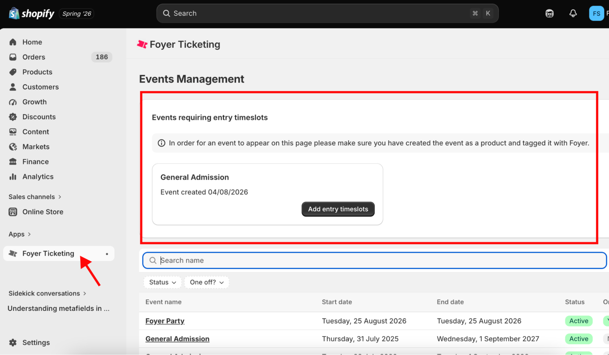

Once you have saved your product in Shopify, navigate to the **Foyer Ticketing** app from the **Apps** section in the left-hand menu.

In the **Events requiring entry timeslots** panel, you should see the product you created (for example, **General Admission** **tickets**).

Click **Add entry timeslots.**

