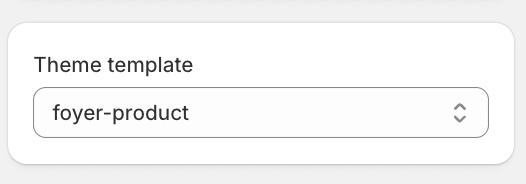
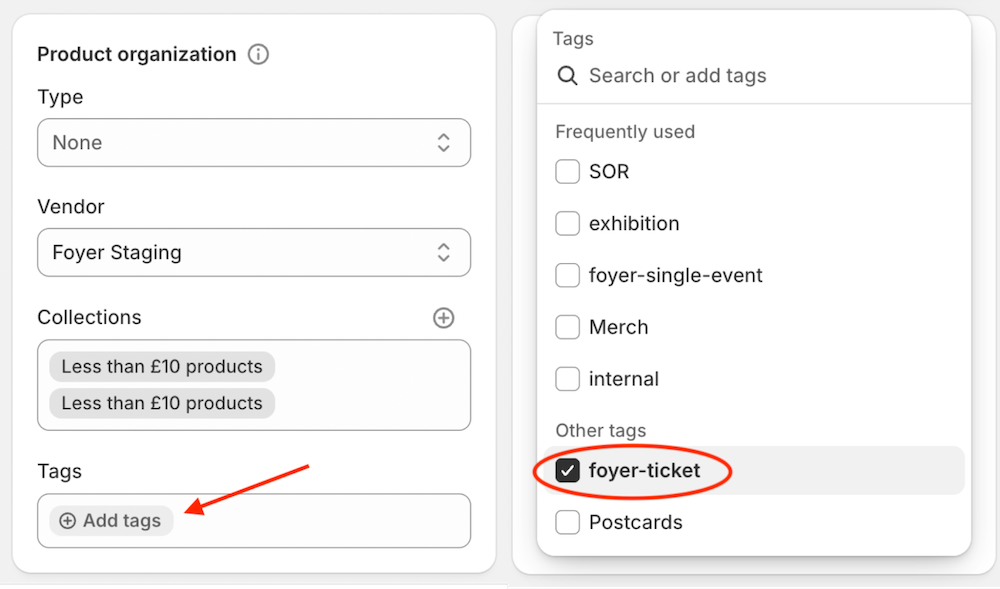

## Part 1: Create your ticket product in Shopify

Before configuring your event type and timeslots in Foyer, you’ll need to create your ticketed product in Shopify. Once created, the product will become available in the Foyer app, where you can select it, configure the event type, and set your available timeslots.

- In Shopify select **Products** from the side menu then click **Add product**.

See Shopify’s guide on **[Adding and updating products](https://help.shopify.com/en/manual/products/add-update-products)**.

- Set your **Theme template** to **foyer-product**

- Tag your new product with **foyer-ticket**

- The **Foyer Order** tag must then be added to the order for it to be recognised as a Foyer ticket order and appear on the Timeslot page in the app.
- The **Foyer Order** tag can be added to orders manually, or automatically using Shopify Flow.

**Note**: When creating your first Foyer product, the **foyer-ticket** and **foyer-single-event** tags need to be created by typing them in. Once created on the first product, they will be saved and available as frequently used fields for all subsequent Foyer products. They will automatically associate the product with the Foyer app. 

Must tag the orders Foyer Order for them to appear in the timeslot page using Shopify Flow: New order > tag is equal to foyer-ticket > Add foyer order tag

- Add your **ticket types** as product **variants** of your new product. For example, you might create variants for Adults, Under 18s, and Concession tickets.

See Shopify’s guide on **[Variants](https://help.shopify.com/en/manual/products/variants)**.