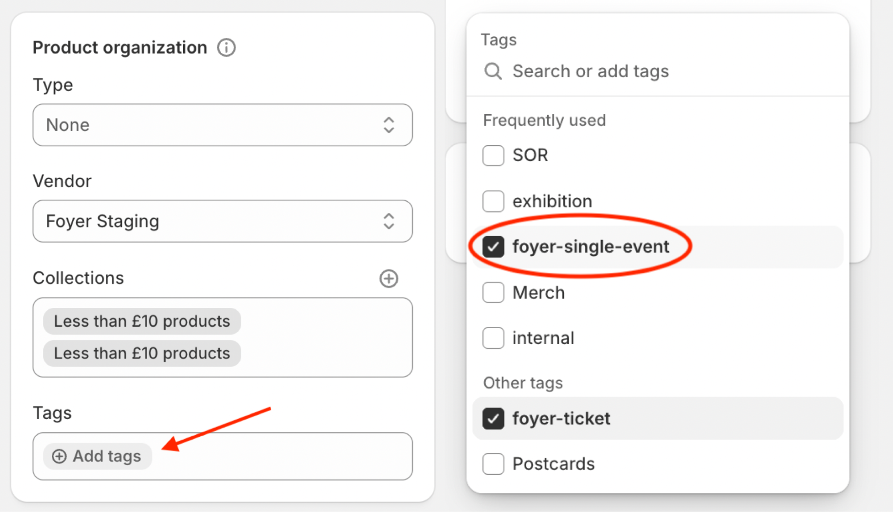
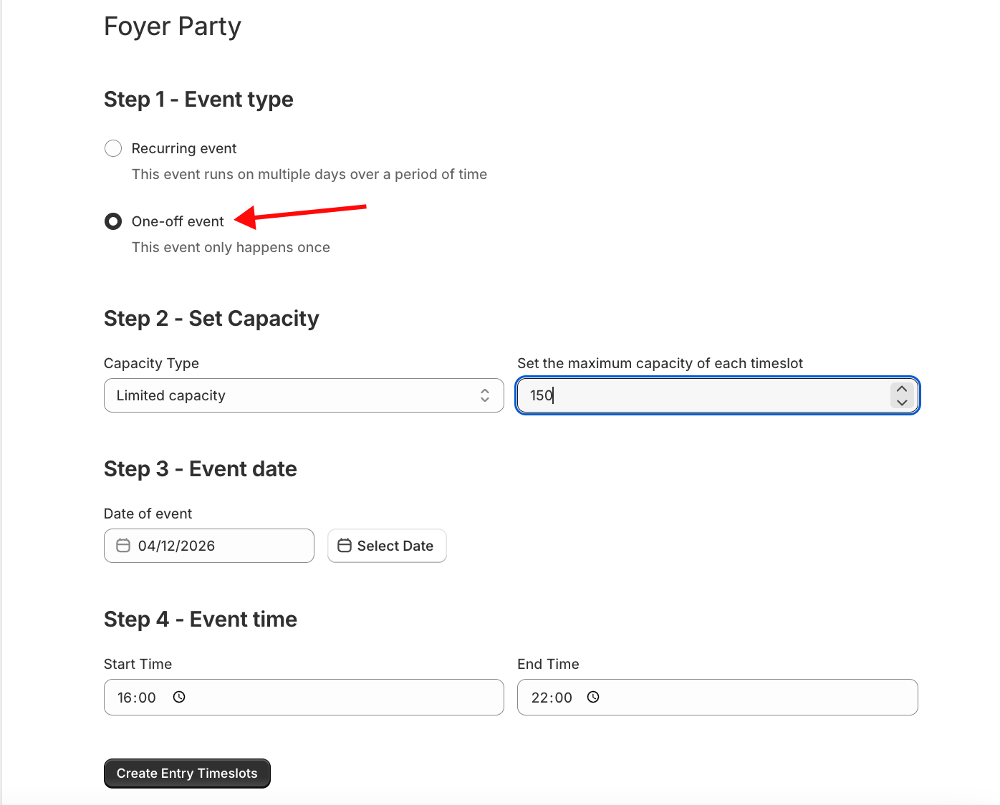
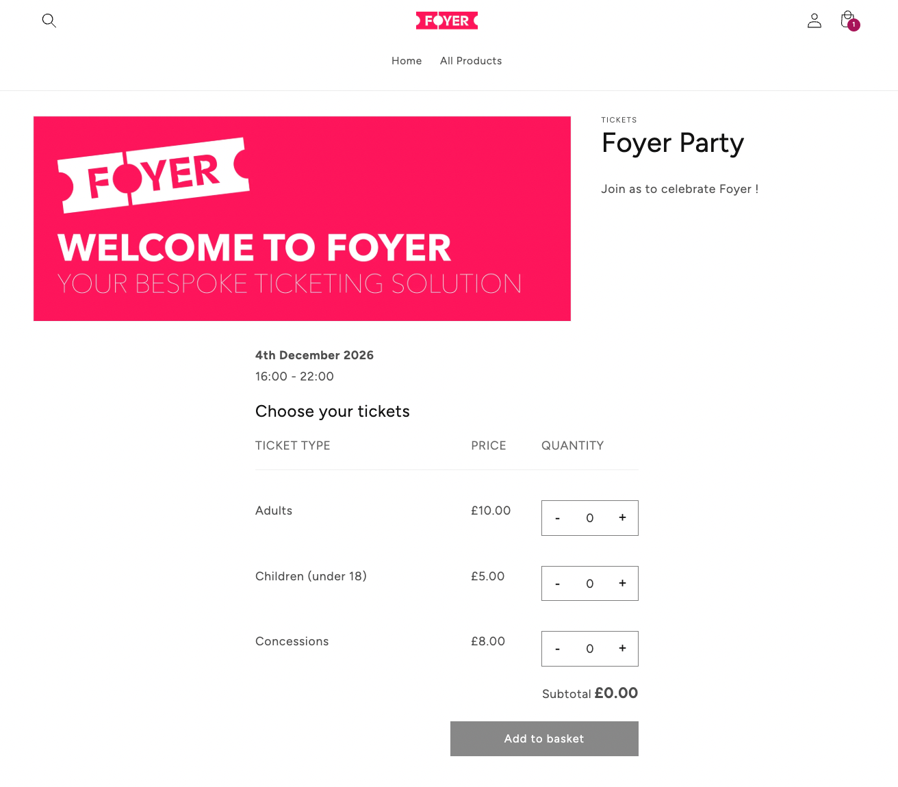

- For one-off events follow the same steps to add the product as you would for recurring events.
- In addition to the  **foyer-ticket** tag, add the **foyer-single-event** tag.

- Once you have completed the remaining product setup fields as you would for recurring events, navigate to your event in the Foyer app.
- Click **Add entry timeslots**.
- Select the **One-off event** type and set the event capacity and timings, then click **Create Entry Timeslots** to save.

Customers will now be able to view and select ticket options for your one-off event:

