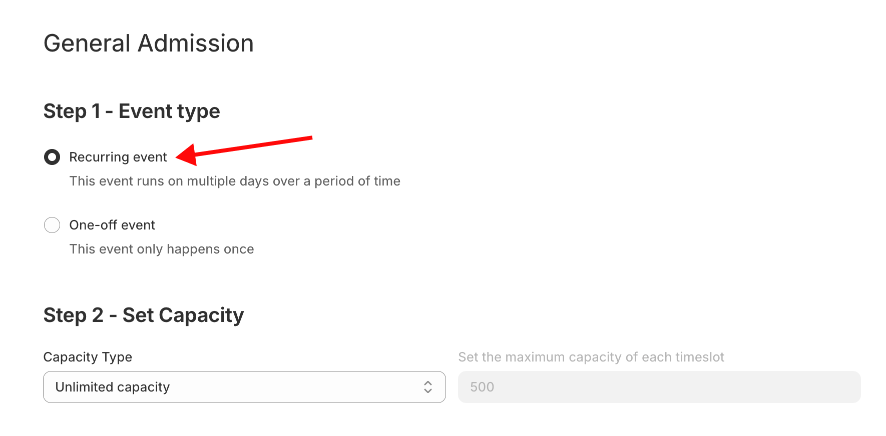
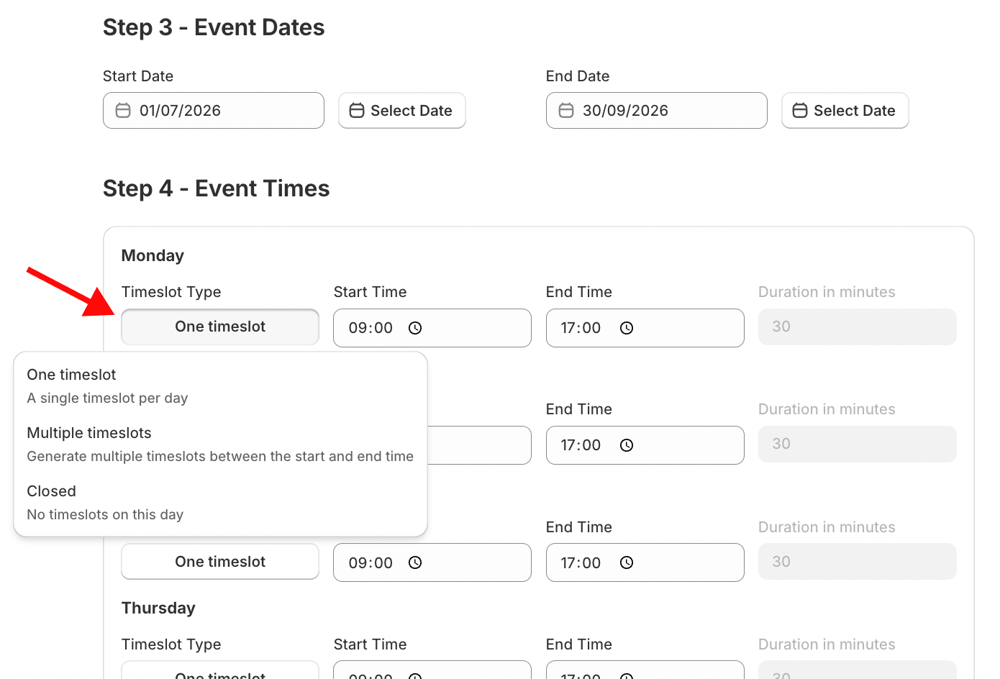
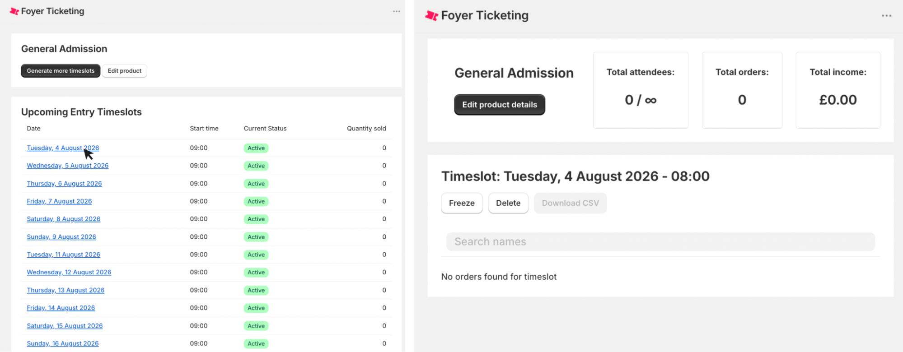
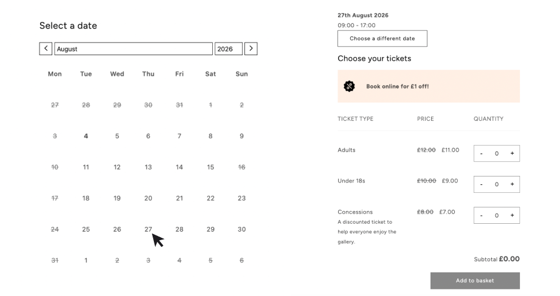

In this example, you are setting up General Admission so you should select the **Recurring event** type. If your general admission never reaches capacity leave the **maximum capacity** setting blank.

Next you will need to add your General Admission **days** and **timeslots**, there are 3 timeslot types. Use:

- **One timeslot** if a ticket holder can arrive at any point within your set hours.
- **Multiple timeslots** to create timed entries.

**Note**: consider your final entry time, as this may need to be earlier than your actual closing time to allow visitors enough time to complete their visit.

- **Closed** for unavailable days eg. if you are closed on Mondays.

Before saving, you can add specific dates to exclude for exceptional closures such as private events.

Click **Create Entry Timeslots** to save. Your upcoming timeslots will then appear in a list view. You can select a date to view details for that timeslot, including the total number of attendees, orders, and income.

Customers purchasing your ticketed product will now be able to choose an available date and entry timeslot:

