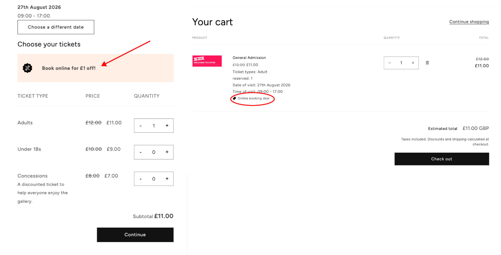

- You can add discounts, for example if you are incentivising an online purchase with a lower price.
- Use the **Foyer - Discount Icon** and **Foyer - Discount Message** fields to customise the icon and text shown in your discount banner.
- Use the **Foyer - Discount Type** field to specify the discount amount.

:::note
These metafields only control the discount information displayed to customers. To apply the discount at checkout, you must also create a corresponding discount in Shopify Admin > Discounts. Foyer does not create or apply Shopify discounts automatically.

- In your Shopify admin go to Discounts in the side menu and select Create discount.
- You will be asked to Select discount type, select Amount off products.
- Configure your discount settings and select which product/s this should apply to.
- When you have completed all your discount settings click to save.

See Shopify's guide on ++**[Amount off discounts](https://help.shopify.com/en/manual/discounts/discount-types/percentage-fixed-amount)**++.

:::