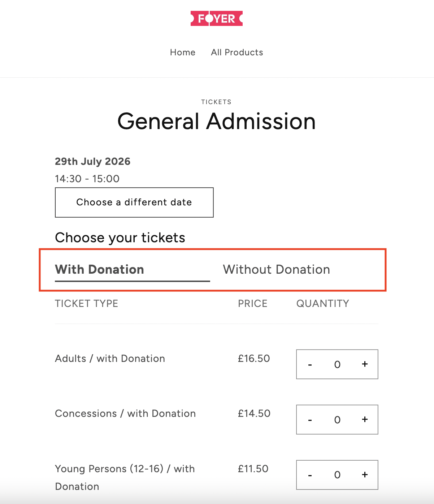
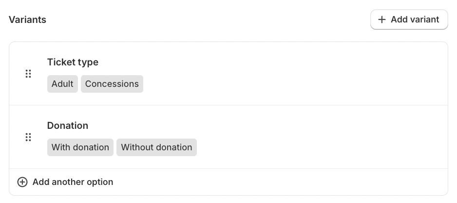
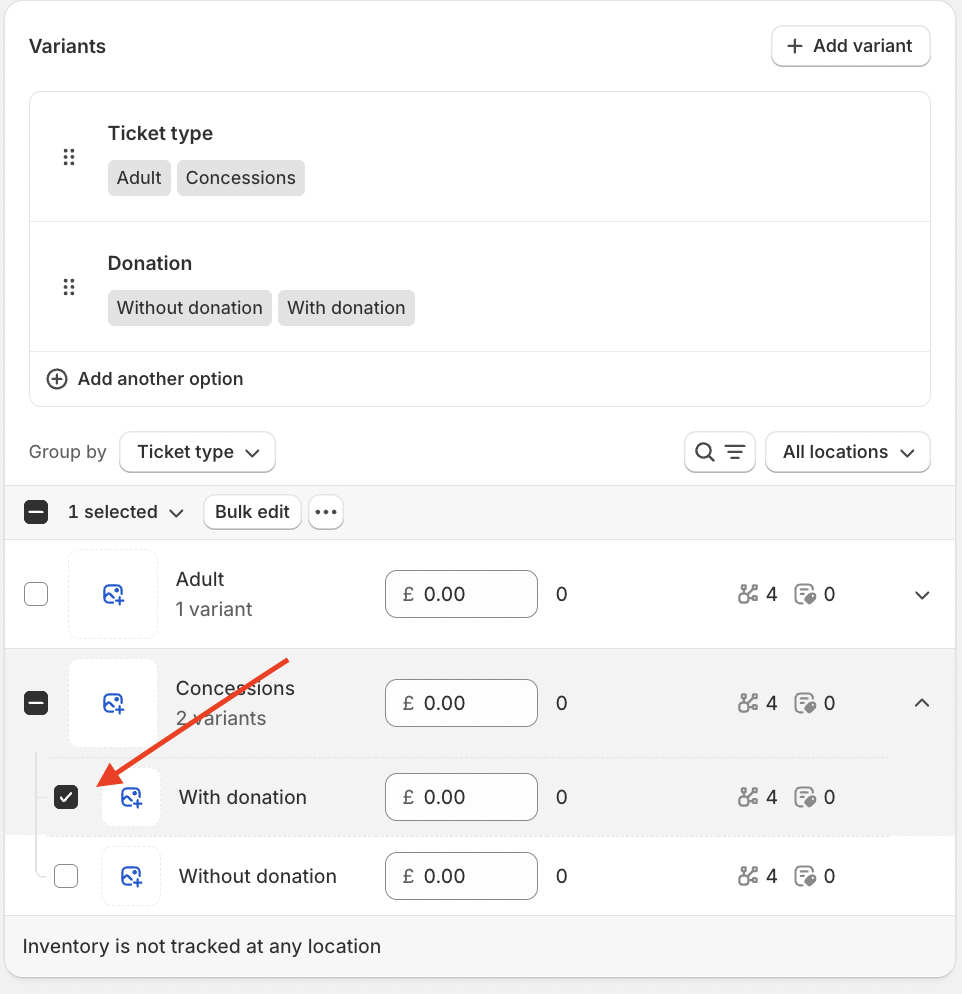
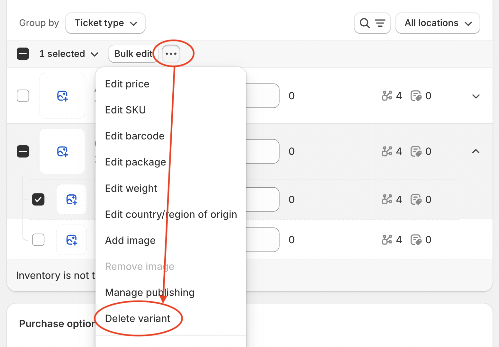

You can present your ticket options in a toggle view, allowing customers to choose between prices with or without donations. This makes it easier for them to select their preferred pricing option.

To set this up:

In your product **Variants** block after you have created your **ticket type variants** (Adults, Under 18’s, Concessions etc), create another "custom option" with the name "**Donation**" and add the variants "**with donation**" and "**without donation**".

Add the prices for each variant.

**Note:** If a ticket type is not available with both donation settings (with donation and without donation), select the relevant variant and delete from the **More options** (•••) menu

You can add a message to encourage customers to book their ticket with a donation. To set this up, follow the instructions in the metafields section below.